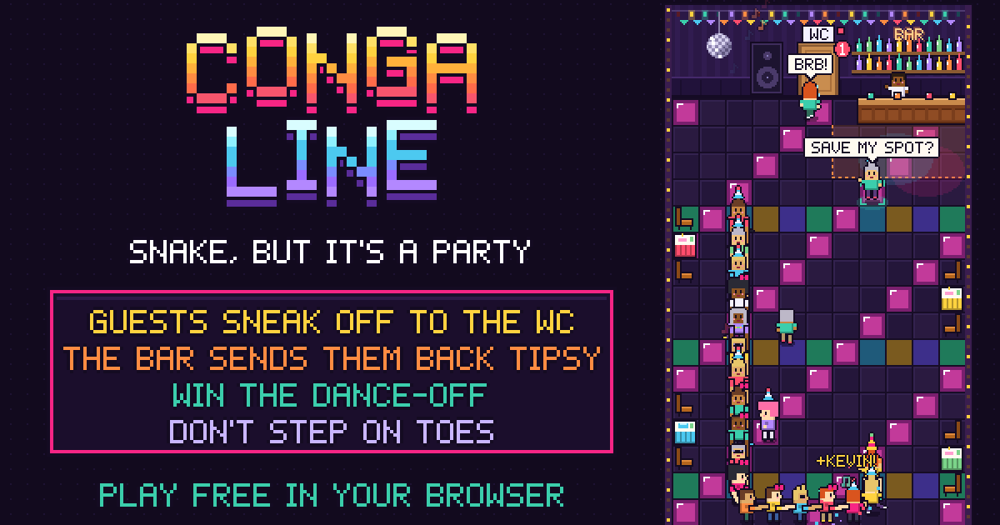

# Conga Line

**Snake, but it's a party.**

### ▶ Play it: https://luisca32.github.io/conga-line/

You lead a conga line around a disco dance floor. Grab the guests waiting on the floor and your line gets longer (and faster). Simple, right? Except:

- **Guests need the WC.** Someone in your line will shout "BRB!" and leave for the bathroom. They come back later and ask you to save their spot.
- **Don't dance past the bar.** Get too close and guests wander off for a drink. They come back tipsy, and picking one up gives you a random power-up.
- **Mind the walls, the snack tables and the bar.** Crash into one, or step on someone's foot in your own line, and the party's over.

### Power-ups (from tipsy guests)

- **Slow dance:** everything slows down for a few seconds.
- **Party mode:** every pickup counts double for a while.
- **Dance-off:** arrows fall from the top. Hit them in rhythm to add guests to your line. Nail most of them and party mode kicks in.

### How to play

| | Phone | Laptop |
|---|---|---|
| Start | Tap | Space or Enter |
| Steer | Swipe | Arrow keys or WASD |
| Dance-off arrows | Swipe | Arrow keys or WASD |
| Sound on/off | Speaker icon | M |

Best on a phone held upright. No install, no sign-up: it's one HTML file (`index.html`) with pixel art and sound made in code.
